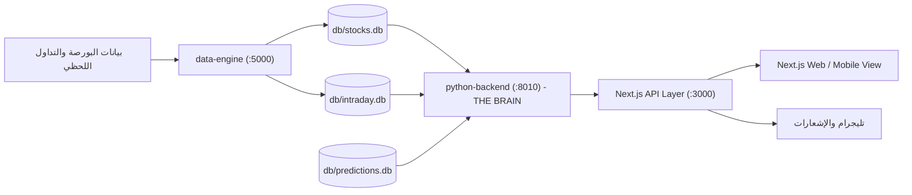

# 🏗️ الملف الثاني: المعمارية التقنية ومصفوفة قواعد البيانات والبنية التحتية
**منصة دليل الاستثمار والتحليل الكمي — GLMinvestment**  
**المشرف العام وصاحب المنصة:** الأستاذ محسن  
**المدير العام والمسؤول التنفيذي:** Chief Market Analyst & Systems Architect  
**تاريخ التوثيق والاعتماد:** 12 أكتوبر 2026

---

## 🖥️ 1. مواصفات البنية التحتية والبيئة التشغيلية (Hardware & System Specs)

* **الخادم (VPS Environment):**
  * **المعالج:** 2 vCPU Cores.
  * **الذاكرة العشوائية (RAM):** 8.0 GB (الاستهلاك الفعلي للمنصة مستقر حول 600 - 800 MB، بنسبة استخدام عام أقل من 10%).
  * **التخزين (Disk):** 100 GB SSD (المستخدم الفعلي أقل من 25 GB).
  * **نظام التشغيل والبيئة:** Ubuntu Linux / WSL2، بيئة Node.js v20+، بايثون 3.12+ / 3.13.

---

## 🗄️ 2. مصفوفة قواعد البيانات المعتمدة (Canonical Database Matrix)

تعتمد المنصة معمارية SQLite عالية الكفاءة مع قفل عمليات القراءة والكتابة والاعتماد الحصري على 4 قواعد بيانات حية فقط:

| اسم القاعدة | المسار الفعلي | الحجم التقريبي | الجداول الحيوية | الحالة والوظيفة |
| :--- | :--- | :--- | :--- | :--- |
| **قاعدة الأسهم والأسعار** | `db/stocks.db` | ~13.5 MB | `stocks`, `stock_daily_prices`, `stock_sectors_ar`, `stock_realtime_quotes` | **Canonical (المصدر الوحيد للأسعار)**. تضم 100,619 شمعة تاريخية لـ 1,213 سهم من سبتمبر 2025 إلى أكتوبر 2026. |
| **قاعدة الصفقات والرادار** | `db/predictions.db` | ~235 MB | `radar_signal_tracking`, `predictions`, `prediction_history`, `closed_predictions` | **Canonical (محرك التقييم)**. تتبع 1,102 إشارة رادار وحسابات نسب النجاح وأرشيف الصفقات. |
| **قاعدة التكات والسيولة اللحظية** | `db/intraday.db` | ~427 MB | `stock_intraday`, `stock_intraday_archive`, `intraday_meta` | **Canonical (شريان السيولة اللحظي)**. تخزن 700k+ تكة، ومستويات الـ POC والـ CVD، وتتحفظ بآخر 3 جلسات تداول لـ EGX30. |
| **قاعدة الهوية والاشتراكات** | `db/auth.db` | ~330 KB | `users`, `subscriptions`, `sessions`, `api_tokens` | **Canonical**. مسؤولة عن المصادقة، خطط الاشتراكات وبوابات الدفع (InstaPay/Fawry). |
| ⛔ **قواعد محظورة وتالفة** | `db/price_history.db` + `db/market.db` | — | — | **ممنوع لمسها نهائياً**. تم عزلها وتفريغها بسبب تلف هيكلي قديم. |

---

## ⚙️ 3. بيئة العمليات وإدارة العمليات (PM2 Ecosystem)

تعمل المنصة بنظام إدارة العمليات المستمر PM2 تحت المستخدم `meme` وتتكون من الخدمات التالية:

```
┌────┬─────────────────────────────┬─────────────┬─────────┬─────────┬──────────┬────────┬──────┬───────────┐
│ id │ name                        │ namespace   │ version │ port    │ status   │ uptime │ cpu  │ mem       │
├────┼─────────────────────────────┼─────────────┼─────────┼─────────┼──────────┼────────┼──────┼───────────┤
│ 0  │ python-backend              │ default     │ 3.4.41  │ :8010   │ online   │ مستقر  │ 0%   │ ~160 MB   │
│ 1  │ data-engine                 │ default     │ 3.4.41  │ :5000   │ online   │ مستقر  │ 0%   │ ~38 MB    │
│ 2  │ nextjs                      │ default     │ 14.2.28 │ :3000   │ online   │ مستقر  │ 0%   │ ~140 MB   │
│ 3  │ ws-service                  │ default     │ 1.0.0   │ :3005   │ online   │ مستقر  │ 0%   │ ~75 MB    │
│ 5  │ telegram-interactive-bot    │ default     │ 3.4.41  │ —       │ online   │ مستقر  │ 0%   │ ~84 MB    │
│ 7  │ news-agent                  │ default     │ 3.4.41  │ —       │ online   │ مستقر  │ 0%   │ ~105 MB   │
└────┴─────────────────────────────┴─────────────┴─────────┴─────────┴──────────┴────────┴──────┴───────────┘
```

### وظيفة كل خدمة:
1. **`python-backend` (Port 8010):**
   - العقل التحليلي الأساسي للمنصة المكتوب بـ Python (FastAPI / Flask).
   - يتولى حسابات وايكوف، ماسح السيولة، مؤشر MFI، ونقاط الدعم والمقاومة، ومسارات الرادار.
2. **`nextjs` (Port 3000):**
   - خادم الإنتاج لـ Next.js 14 App Router.
   - يعرض الواجهات، ويدير جلسات المستخدمين، ويعمل كـ Proxy خفيف يستدعي الـ `python-backend` عبر مسارات `/api/...`.
3. **`data-engine` (Port 5000):**
   - جلب وتحديث الأسعار اللحظية ومزامنة دفاتر الأوامر والبيانات السوقية المباشرة.
4. **`ws-service` (Port 3005):**
   - بث تدفقات الأسعار والتكات الحية للواجهات عبر WebSockets.
5. **`news-agent` & `telegram-interactive-bot`:**
   - متابعة الأخبار المالية لحظياً، وبوت التفاعل وإرسال التنبيهات المباشرة للمشتركين على تليجرام.

---

## 🔄 4. خط تدفق البيانات وتكامل الأنظمة (Data Flow Architecture)



---

## 🔒 5. أمان الذاكرة والتعامل مع قيود العتاد (Low-Resource Optimization)

* **استراتيجية الذاكرة:** إجمالي استهلاك الذاكرة لجميع خدمات المنصة مجتمعة لا يتجاوز 700 ميجابايت من أصل 8 جيجابايت متوفرة.
* **سياسة الذكاء الاصطناعي:** تم حظر النماذج المحلية الثقيلة، واستبدالها بنموذج **DeepSeek Cloud** للمهام النصية، ونموذج **LightGBM** الخفيف جداً (<400MB) للمهام الكمية والتصنيف التوقعي دون استنزاف المعالج.
