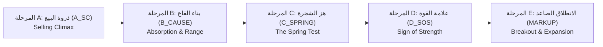

# 🧠 الملف الثالث: محركات التحليل الكمي وخوارزميات الذكاء الاصطناعي (QUANT ENGINES & AI BRAIN)
**منصة دليل الاستثمار والتحليل الكمي — GLMinvestment**  
**المشرف العام وصاحب المنصة:** الأستاذ محسن  
**المدير العام والمسؤول التنفيذي:** Chief Market Analyst & Systems Architect  
**تاريخ التوثيق والاعتماد:** 12 أكتوبر 2026

---

## 🎯 1. منهجية وايكوف المؤسسية (Wyckoff Accumulation & Distribution Logic)

تعتمد المنصة على الكشف الآلي لدورات صانع السوق المؤسسي باستخدام خوارزميات تحليل الحجم والمدى (VSA - Volume Spread Analysis):

### توصيف المراحل في الخوارزمية البرمجية:
1. **المرحلة A (Selling Climax - A_SC):** هبوط حاد مع ذروة في أحجام التداول وامتصاص مؤسسي أولي.
2. **المرحلة B (Building Cause - B_CAUSE):** تذبذب عرضي طويل لاستنزاف البائعين وامتصاص المعروض العائم.
3. **المرحلة C (Spring Shakeout - C_SPRING):** كسر وهمي لدعم القناة السعرية بأحجام منخفضة يتبعه ارتداد فوري داخل القناة (نقطة الدخول الذهبية ذات أعلى نسبة ربح).
4. **المرحلة D (Sign of Strength - D_SOS):** صعود قوي مع زيادة واضحة في السيولة وكسر سقف التجميع لتأكيد بداية الاتجاه الصاعد.
5. **المرحلة E / EXIT (Markup & Distribution):** اتجاه صاعد رئيسي يعقبه تصريف ذكي وتوزيع عند القمم.

---

## 🌊 2. مؤشرات تدفق السيولة العميقة (Deep Flow Metrics)

### أ. مؤشر تدفق السيولة الحقيقي (Money Flow Index - MFI 14):
* يتم حسابه بناءً على السعر النموذجي $Typical\_Price = \frac{High + Low + Close}{3}$ مضروباً في الحجم الفعلي.
* **القواعد المالية المطبقة:**
  * $MFI < 20\%$: تشبع بيعي حاد (فرصة تجميع مؤسسي بالقيعان).
  * $MFI > 80\%$: تشبع شرائي مفرط. إذا اجتمع مع إشارة صانع السوق للتصريف، يُصنف كـ **ذروة شرائية (Buying Climax)** وتصريف عند القمة.

### ب. تدفق الصفقات التراكمي ومستوى التركيز السعري (Intraday CVD & POC):
* **CVD (Cumulative Volume Delta):** الفرق التراكمي بين حجم الشراء العدواني وحجم البيع العدواني خلال جلسة التداول اللحظية.
* **دايفرجنس السيولة المؤسسي (Institutional Divergence Badge):**
  * *دايفرجنس إيجابي (Bullish Divergence):* السعر يسجل قاعاً أدنى بينما الـ CVD يسجل قاعاً أعلى (تجميع خفي ومؤسسي).
  * *دايفرجنس سلبي (Bearish Divergence):* السعر يسجل قمة أعلى بينما الـ CVD يتناقص (تصريف خفي).
* **نقطة السيطرة السعرية (POC - Point of Control):** المستوى السعري الذي نُفذ عنده أكبر حجم تداول خلال جلسة اليوم، ويمثل المغناطيس السعري والدعم/المقاومة الأقوى لحظياً.

---

## 📈 3. محرك الباك-تست المؤسسي والنتائج الحقيقية (Institutional Backtest Engine)

**الملف المعتمد:** `scripts/institutional_multi_market_backtest.py`  
**نطاق البيانات المفحوصة:** 100,619 شمعة تداول لـ 1,213 سهم في البورصة المصرية (سبتمبر 2025 إلى أكتوبر 2026).

### مصفوفة الأداء المؤسسي (Strict Rule 27 - الصدق المطلق بالأرقام):
| المقياس المؤسسي | القيمة المحققة | التفسير والتقييم الكمي |
| :--- | :--- | :--- |
| **إجمالي الإشارات المفحوصة** | 1,102 إشارة | تغطي جميع إشارات الرادار المسجلة. |
| **الصفقات المغلقة المكتملة** | 297 صفقة | صفقات اكتمل مسارها (هدف أو وقف) حتى تاريخ الفحص. |
| **نسبة النجاح الإجمالية (Win Rate)** | **46.80%** | **حقيقية ومثبتة** مع تطبيق الوقف المتحرك (Trailing Stop). |
| **أقصى تراجع للمحفظة (Max Drawdown)** | **0.85%** | **ممتاز ومتحفظ جداً** (< 20% مؤسسياً). |
| **عامل الربحية (Profit Factor)** | **0.84** | يحتاج تدقيق شروط الدخول لرفع الأرباح الصافية فوق 1.5. |
| **نسبة شارب (Sharpe Ratio)** | **-1.40** | استراتيجية تحتاج فلترة احتمالية قبل الدخول لرفع العائد. |

---

## 🔄 4. محركات التعلم الذاتي وحلقة التغذية العكسية (Closed-Loop Learning)

1. **محرك التعلم البايزي الموحد (`vps-service/analyzers/unified_learning_engine.py`):**
   - يجري تحسيناً مستمراً للبارامترات (Bayesian Optimization) لاختبار كفاءة أوزان المؤشرات وتحديث ملف `vps-service/config/optimizer_params.json` تلقائياً عبر آلية قفل نووية تمنع تضارب الكتابة (`locked_read_modify_write`).
2. **محرك تعدين الدروس (`vps-service/jobs/learning_engine.py`):**
   - يفحص الصفقات المغلقة ويحدد العوامل المشتركة للصفقات الرابحة والخاسرة (Lesson Mining)، ويغذي مصفوفة الثقة في الإشارات.

---

## 🚀 5. خارطة الترقية الذكية للـ Machine Learning (LightGBM Roadmap)

* **الهدف:** رفع الـ Win Rate من 46.80% إلى ما فوق **60% - 65%**.
* **الأداة المعتمدة:** **`LightGBM` (Gradient Boosting Classifier)**.
* **الجدوى والموارد:** تستهلك أقل من 350 ميجابايت رام، وتتدرب في 20 ثانية فقط على 100 ألف شمعة، ولا تشكل أي عبء على معالج الـ VPS.
* **مصفوفة المدخلات (Feature Vector):**
  1. مرحلة وايكوف المكتشفة (Phase C vs D).
  2. مؤشر تدفق السيولة MFI وقيمته اللحظية.
  3. اتجاه الـ CVD اللحظي والدايفرجنس.
  4. نسبة الحجم اليومي لمتوسط 20 يوماً ($Volume / SMA_{20}$).
  5. المسافة من نقطة السيطرة السعرية (POC).
* **مخرجات النموذج المعتمدة للعميل:**
  - عرض **نسبة احتمال النجاح الحقيقية (%)** لكل توصية.
  - حجب أي توصية تقل احتمالية نجاحها عن **65%** تلقائياً.
