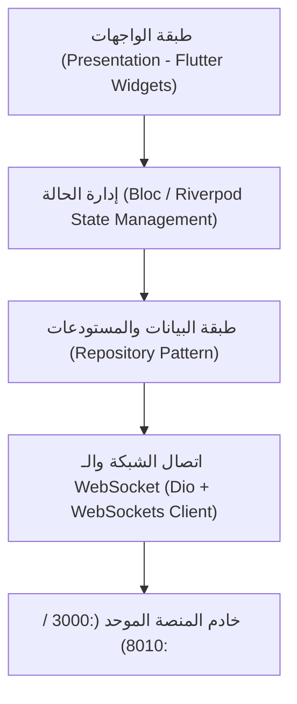

# 📱 الملف الرابع: واجهات المستخدم وتجربة الموبايل (FRONTEND UI & MOBILE EXPERIENCE)
**منصة دليل الاستثمار والتحليل الكمي — GLMinvestment**  
**المشرف العام وصاحب المنصة:** الأستاذ محسن  
**المدير العام والمسؤول التنفيذي:** Chief Market Analyst & Systems Architect  
**تاريخ التوثيق والاعتماد:** 12 أكتوبر 2026

---

## 🖥️ 1. رادار صانع السوق والدرج التفصيلي (Maker Radar & Stock Detail Drawer)

المكون الرئيسي: `src/modules/predictions/components/MakerRadarTab.tsx`

### المكونات التفاعلية المدمجة:
1. **شريط فلترة وايكوف الفوري (Wyckoff Screener Quick Filters):**
   * 🎯 **صيد قيعان وايكوف (Spring Phase C):** لفرز الأسهم التي في مرحلة كسر الدعم الوهمي والارتداد الفوري.
   * ⚡ **علامة القوة (SOS Phase D):** لفرز الأسهم التي بدأت اختراق القناة وبدء مرحلة الصعود.
   * زر إعادة التعيين (Reset ✕).
2. **منحنى تتبع مراحل وايكوف (`WyckoffPhaseTracker`):**
   * يعرض شريطاً مرئياً خماسي المراحل: `A_SC` (ذروة البيع) ➔ `B_CAUSE` (بناء القاع) ➔ `C_SPRING` (هز الشجرة) ➔ `D_SOS` (علامة القوة) ➔ `EXIT` (خروج).
   * إبراز المرحلة الحالية للسهم بدقة مع نقطة مضيئة ومقياس الثقة (Confidence Badge).
3. **مخطط تدفق السيولة اللحظي (`IntradayCvdFlow`):**
   * عرض مسار شمعات الـ 5 دقائق لجلسة التداول اللحظية.
   * رسم خط الـ CVD وتحديد مستويات الـ POC.
   * إظهار شارات الدايفرجنس المؤسسي (Institutional Divergence Badge: Bullish / Bearish).
4. **لقطة الرادار المؤسسية (`MakerRadarSnapshot`):**
   * بطاقة إنفوجرافيك تلخص: دورة الصانع، نشاط المشترين، الحجم النسبي، وصافي السيولة بالجنيه بدقة 100% مطابقة لبيانات الجدول (SSOT Parity).

---

## 🎨 2. زر النشر الموحد واستوديو التسويق (Unified Publish & Marketing Studio)

المكون: `src/modules/publishing/components/UnifiedPublishButton.tsx`  
والمسار المساعد: `src/modules/publishing/lib/stock-publish-text.ts`

### القدرات والوظائف المؤسسية:
1. **توليد بطاقات المشاركة لشبكات التواصل (Social Share Cards):**
   * توليد بطاقات صور عالية الجودة بنسب أبعاد متعددة (مربعة 1:1 للإنستجرام وتويتر، ورأسية 9:16 للستوري والتليجرام).
   * استخدام خطوط عربية حديثة وتدرجات احترافية داكنة (Dark Glassmorphism).
2. **صياغة التقرير الاحترافي للحافظة (Clipboard Professional Formatter):**
   * صياغة نصية جاهزة للمشاركة الفورية تضم: حالة السهم، سلوك وايكوف، مؤشر MFI المفسر، سعر الارتكاز للدخول، المستهدفات، والوقف الفولاذي.
   * **تطبيق صمام الأمان (Sanity Gate):** إدراج تنبيهات منع المطاردة (No-Chase) وحساب نسبة المخاطرة للعائد تلقائياً.

---

## 📱 3. المعمارية الهندسية لتطبيق الموبايل (Flutter Architecture)

المسار المرجعي: `mobile/` ومستند `Documentation/09-FLUTTER-APP.md`

### شاشات التطبيق الأساسية:
1. **شاشة رادار الصانع (Mobile Maker Radar):** بطاقات سريعة بتحديث حي لحركة السيولة والتجميع.
2. **شاشة تفاصيل السهم والعمق اللحظي:** شارت الشموع اللحظية وتدفق الـ CVD ومستويات وايكوف.
3. **شاشة التنبيهات الذكية (Push Notifications):** إشعارات فورية عند رصد اختراق مرحلة Spring Phase C أو كسر وقوف الخسارة.
4. **شاشة إدارة المحفظة وحساب الزكاة:** أدوات المستثمر لإدارة الصفقات ومتابعة الأرباح وحساب زكاة الأسهم وفق الضوابط الشرعية.

---

## ✨ 4. معايير التصميم والجماليات (Design System & UX Standards)

* **التصميم المعتمد:** Dark Glassmorphism مؤسسي مستوحى من كبريات المنصات العالمية (TradingView و Bloomberg).
* **الألوان والرموز:** يُمنع استخدام أكواد الألوان المباشرة (Raw Hex) في المكونات الجديدة؛ يتم الاعتماد الحصري على رموز النظام الموحدة (Design Tokens من Tailwind / CSS Variables).
* **التوافق والاستجابة:** تجربة سلسة 100% على مختلف أحجام الشاشات (الهواتف المحمولة، التابلت، وشاشات الحواسب العريضة).
