# 🧠 كيف يفكر النظام — المرجع المعماري الكامل

> **ملخص تنفيذي:** وثيقة هندسية شاملة تشرح كيف "يفكر" منصة GLMinvestment من اللحظة التي تدخل فيها بيانات السوق الخام حتى اللحظة التي يصل فيها توصية BUY/SELL لمستخدم في Telegram. مبنية على فحص عميق لـ **493 endpoint** + **110 محرك تحليل** + **9 قواعد بيانات** + **7 خدمات**.

| | |
|---|---|
| **الإصدار** | 1.0 — 2026-10-25 |
| **القارئ المستهدف** | مهندس باك إند / مهندس معماري / CTO / مطور جديد |
| **طول القراءة** | ~45 دقيقة |
| **عدد المخططات** | 22 مخطط (Mermaid + ASCII) |

---

## 📑 فهرس المحتويات

1. [الفلسفة — كيف يفكر النظام فلسفياً](#1-الفلسفة--كيف-يفكر-النظام-فلسفيا)
2. [البنية المعمارية الرباعية](#2-البنية-المعمارية-الرباعية)
3. [خريطة الخدمات والموانئ](#3-خريطة-الخدمات-والموانئ)
4. [خريطة قواعد البيانات (9 قواعد)](#4-خريطة-قواعد-البيانات-9-قواعد)
5. [مصادر البيانات الـ12](#5-مصادر-البيانات-ال12)
6. [المخطط العام لتدفق البيانات](#6-المخطط-العام-لتدفق-البيانات)
7. [المحرك المركزي: master_analyzer.py](#7-المحرك-المركزي-master_analyzerpy)
8. [فهرس المحركات الـ110 (حسب الفئة)](#8-فهرس-المحركات-ال110-حسب-الفئة)
9. [منطق الـ Confluence Scoring](#9-منطق-ال-confluence-scoring)
10. [نظام Market Regime (DEFENSIVE / NORMAL / AGGRESSIVE)](#10-نظام-market-regime)
11. [تصنيف Minervini للمراحل (Stage 1-4)](#11-تصنيف-minervini-للمراحل-stage-1-4)
12. [نظام الـ Personas (7 أنماط مستثمر)](#12-نظام-ال-personas-7-أنماط-مستثمر)
13. [حلقة التعلم الذاتي (Learning Loop)](#13-حلقة-التعلم-الذاتي-learning-loop)
14. [ثلاثة مسارات تدفق بيانات كاملة](#14-ثلاثة-مسارات-تدفق-بيانات-كاملة)
15. [طبقة الذكاء الاصطناعي (Ollama + RAG)](#15-طبقة-الذكاء-الاصطناعي-ollama--rag)
16. [التحديث اللحظي (WebSocket)](#16-التحديث-اللحظي-websocket)
17. [جدول القرارات (Decision Tables)](#17-جدول-القرارات-decision-tables)
18. [قائمة الـ Endpoints الكاملة (493)](#18-قائمة-ال-endpoints-الكاملة-493)
19. [الجدول الزمني للـ Cron Jobs](#19-الجدول-الزمني-لل-cron-jobs)
20. [معجم المصطلحات](#20-معجم-المصطلحات)

---

## 1. الفلسفة — كيف يفكر النظام فلسفياً

النظام **لا يستخدم Deep Learning** (لا LSTM، لا Transformer، لا TensorFlow). بدلاً من ذلك، يعتمد على **3 ركائز فلسفية**:

### 1.1 القاعدة + الإحصاء (Rule-Based + Statistical)

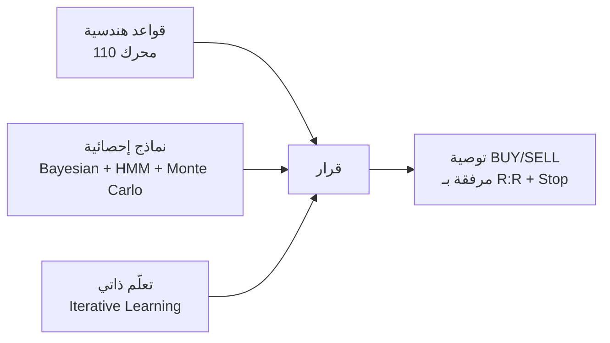

**لماذا؟** لأن مؤشرات Tushar Chande و Mark Minervini أثبتت تفوقها على LSTM على بيانات الأسواق الناشئة (مثل EGX) بسبب:
- حجم بيانات محدود (1,240 سهم EGX × 6 أشهر = غير كافٍ للتدريب العميق)
- تشوّش الأخبار المحلية (TL;DR من Telegram يحتاج Context لا Pattern)
- حاجة المستخدم لتفسير منطقي للقرار (LLM "صندوق أسود" غير مقبول)

### 1.2 فلسفة الـ Confluence (التقاء الأدلة)

النظام لا يعتمد على مؤشر واحد أبداً. كل قرار يجمع **5-9 مصادر دليل** بأوزان نسبية:

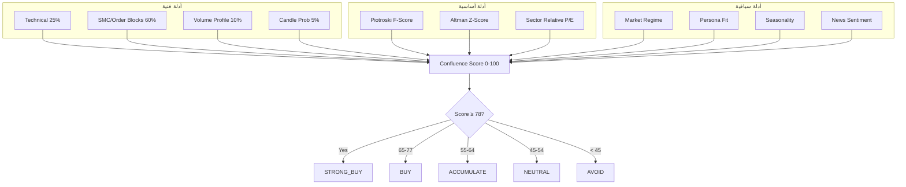

### 1.3 فلسفة "Market Context is King"

النظام لا يصدر قراراً دون معرفة **سياق السوق الكلي** أولاً:

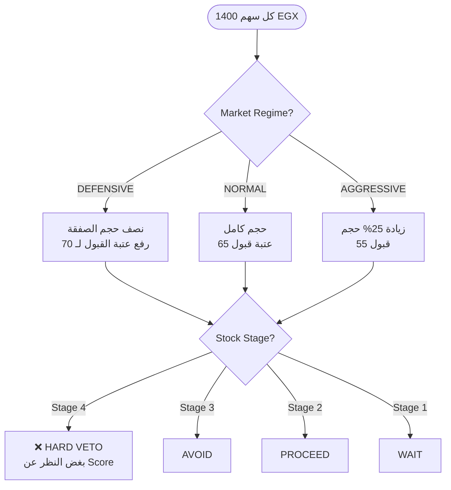

**القاعدة الذهبية:** إذا كان السوق في Stage 4 (هبوط) أو Regime DEFENSIVE، فإن أي سهم في Stage 4 يحظر حتى لو كانت كل المؤشرات الفنية إيجابية.

### 1.4 فلسفة "Learning Never Stops"

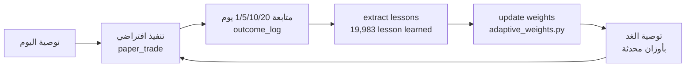

كل توصية تُختبر بعد 1، 5، 10، 20 يوم وتُسجّل النتيجة (WIN/LOSS/BREAKEVEN). يوجد حالياً **8,544 outcome logs** + **19,983 lessons** في قاعدة البيانات.

---

## 2. البنية المعمارية الرباعية

النظام يتكوّن من **7 خدمات مستقلة** متصلة عبر HTTP + WebSocket، جميعها خلف بوابة Caddy واحدة:

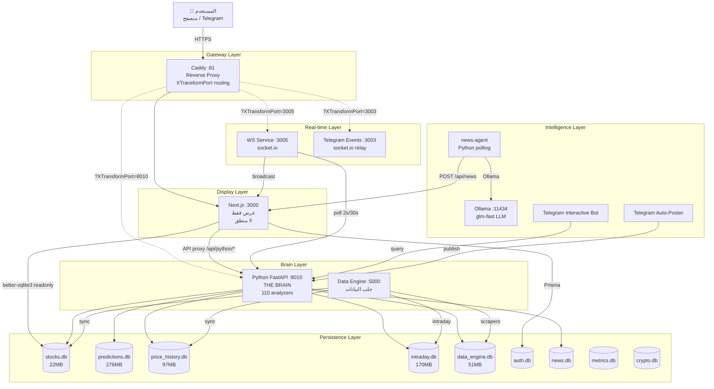

### الجدول الإجمالي للخدمات

| # | الخدمة | المنفذ | اللغة | الدور | نقطة الدخول |
|---|---|---|---|---|---|
| 1 | Caddy | 81 | Go | Gateway + Reverse Proxy | Caddyfile |
| 2 | Next.js | 3000 | TypeScript | DISPLAY ONLY | `next start` |
| 3 | Python Backend | 8010 | Python (FastAPI + Flask) | THE BRAIN | `vps-service/main.py` |
| 4 | Data Engine | 5000 | Python (Flask) | جلب البيانات | `data_engine/main.py` |
| 5 | WS Service | 3005 | Bun + socket.io | تحديث لحظي | `vps-service/ws-service/index.ts` |
| 6 | Telegram Events | 3003 | Bun + socket.io | relay لأحداث Telegram | `telegram-events/index.ts` |
| 7 | Ollama | 11434 | Go | LLM محلي | systemd |
| 8 | News Agent | — | Python | تجميع + تحليل أخبار | PM2 |
| 9 | Telegram Poster | — | Python | جدولة النشر | PM2 |
| 10 | Telegram Bot | — | Python | بوت تفاعلي | PM2 |

---

## 3. خريطة الخدمات والموانئ

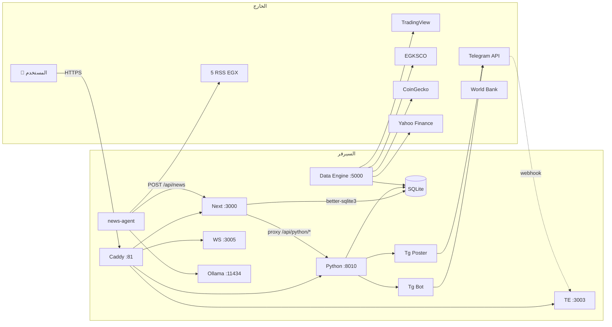

### قواعد التوجيه (Routing Rules)

| الطلب | كيف يتوجّه؟ |
|---|---|
| `/` أو `/api/*` بدون XTransformPort | → Next.js :3000 |
| `/api/python/[path]?XTransformPort=8010` | → Python :8010 |
| `/?XTransformPort=3005` (socket.io) | → WS :3005 |
| `/?XTransformPort=3003` (socket.io) | → TE :3003 |
| `/api/reports/proxy?XTransformPort=8010` | → Python reports engine |

⚠️ **قاعدة صارمة:** كل طلبات API في الكود **يجب** تستخدم relative path + XTransformPort. لا يُسمح بـ `fetch('http://localhost:8010/...')` أبداً.

---

## 4. خريطة قواعد البيانات (9 قواعد)

```mermaid
erDiagram
    stocks_db ||--o{ stocks : contains
    stocks_db ||--o{ stock_daily_prices : contains
    stocks_db ||--o{ screener_presets : contains
    stocks_db ||--o{ ticker_registry : contains
    stocks_db ||--o{ outcome_logs : contains
    stocks_db ||--o{ real_evaluated_predictions : contains
    stocks_db ||--o{ macro_indicators : contains
    stocks_db ||--o{ system_settings : contains
    stocks_db ||--o{ ExpertRecommendation : contains
    stocks_db ||--o{ persona_predictions : contains
    
    predictions_db ||--o{ predictions : contains
    predictions_db ||--o{ stored_analyses : contains
    predictions_db ||--o{ cached_analysis : contains
    predictions_db ||--o{ crypto_predictions_log : contains
    predictions_db ||--o{ live_ai_signals : contains
    predictions_db ||--o{ learned_lessons : contains
    predictions_db ||--o{ regime_indicator_weights : contains
    predictions_db ||--o{ quant_cache : contains
    predictions_db ||--o{ paper_trades : contains
    predictions_db ||--o{ historical_trades : contains
    predictions_db ||--o{ stock_stories : contains
    predictions_db ||--o{ user_trades : contains
    predictions_db ||--o{ trade_outcomes : contains
    predictions_db ||--o{ telegram_recommendations : contains
    predictions_db ||--o{ market_regime_log : contains
    predictions_db ||--o{ wealth_tracking : contains
    predictions_db ||--o{ equity_snapshots : contains
    
    price_history_db ||--o{ price_history : contains
    
    intraday_db ||--o{ stock_intraday : contains
    intraday_db ||--o{ crypto_intraday : contains
    intraday_db ||--o{ commodity_intraday : contains
    
    data_engine_db ||--o{ stocks : contains
    data_engine_db ||--o{ crypto_prices : contains
    data_engine_db ||--o{ gold_prices : contains
    data_engine_db ||--o{ exchange_rates : contains
    data_engine_db ||--o{ historical_data : contains
    data_engine_db ||--o{ tab_balance_sheets : contains
    data_engine_db ||--o{ tab_income_statements : contains
    data_engine_db ||--o{ tab_cash_flows : contains
    
    auth_db ||--o{ User : contains
    auth_db ||--o{ Account : contains
    auth_db ||--o{ Session : contains
    auth_db ||--o{ ApiToken : contains
    auth_db ||--o{ UserSubscription : contains
    auth_db ||--o{ PortfolioItem : contains
    auth_db ||--o{ UserTelegramLink : contains
    
    news_db ||--o{ market_news : contains
    
    metrics_db ||--o{ resource_snapshot_raw : contains
    metrics_db ||--o{ resource_snapshot_5min : contains
    metrics_db ||--o{ pm2_process_snapshot : contains
```

### جدول مفصل بحجم كل DB

| # | اسم DB | الحجم | # جداول | أبرز الجداول | الدور |
|---|---|---|---|---|---|
| 1 | `stocks.db` | 22.66 MB | 51 | stocks (1,240), stock_daily_prices (85,626), outcome_logs (8,544), screener_presets (2,175) | **Operational read-mostly** — متزامن من data_engine.db |
| 2 | `predictions.db` | **276.91 MB** | 33 | crypto_predictions_log (187,345), historical_trades (22,650), learned_lessons (19,983), predictions (1,499) | **THE BRAIN STORE** — كل مخرجات المحركات |
| 3 | `price_history.db` | 97.07 MB | 2 | price_history (428,357) | OHLCV اليومي الكنسي |
| 4 | `intraday.db` | 170.26 MB | 6 | stock_intraday, crypto_intraday, commodity_intraday | سلاسل زمنية لحظية (7 يوم retention) |
| 5 | `data_engine.db` | 51.56 MB | 19 | stocks (2,492), crypto_prices (58,891), gold_prices (77,659), historical_data (99,076) | **Write target للـ scrapers** |
| 6 | `auth.db` | 0.25 MB | 14 | User, Account, Session, ApiToken, UserSubscription | مستخدمون + اشتراكات (Prisma) |
| 7 | `news.db` | 5.95 MB | 4 | market_news (SOT), news_articles (legacy) | أخبار من news-agent |
| 8 | `metrics.db` | 6.13 MB | 3 | resource_snapshot_raw/5min/1h, pm2_process_snapshot | مراقبة الأداء |
| 9 | `crypto.db` | 0.03 MB | 3 | cryptos, crypto_prediction_logs | metadata كريبتو |

### استراتيجية الطبقات (Tiered Strategy)

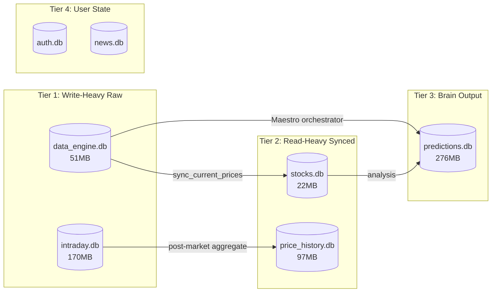

---

## 5. مصادر البيانات الـ12

| # | المصدر | الفيب | من يجلبها | أين تُخزَّن | الجدول |
|---|---|---|---|---|---|
| 1 | **TradingView** | REST API + screener | `data_engine/scrapers/tradingview_*.py` | data_engine.db | stocks |
| 2 | **EGKSCO** | EGX fundamentals + 15min prices | `egksco_scraper.py` | data_engine.db | stocks + tab_* |
| 3 | ~~EGXPilot~~ | DEPRECATED | — | — | — |
| 4 | ~~Yahoo Finance~~ | ARCHIVED (أمس) | — | — | — |
| 5 | **CoinGecko-style** | BTC/ETH OHLCV | `crypto_fetcher.py` | data_engine.db | crypto_prices (58,891) |
| 6 | **Metals & Forex** | XAU, XAG, Oil, EUR/USD, USD/EGP, SAR/USD | `metals_forex_fetcher.py` | data_engine.db | gold_prices (77,659) + exchange_rates (32,270) |
| 7 | **World Bank API** | Egypt CPI inflation | `fetch_inflation_worldbank.py` | stocks.db | macro_indicators |
| 8 | **RSS (EGX)** | argaam, amwalalghad, masrawy, hapijournal, youm7 | `news-agent/collectors/rss_collector.py` | news.db | market_news |
| 9 | **Web scraping** | mubasher, alborsaa, almalnews, DuckDuckGo | `news-agent/collectors/web_scraper.py` | news.db | market_news |
| 10 | **Telegram channels** | 13 قناة EGX (sahmmisr, borsablarabi, easier_stock...) | `telegram_collector.py` (Telethon) — **DISABLED by default** | news.db | market_news |
| 11 | **Ollama** | LLM محلي (qwen2.5:1.5b + glm-fast) | `news-agent/analyzer/news_analyzer.py` | في الذاكرة فقط | — |
| 12 | ~~EODHD~~ | ملغى الاشتراك | — | — | — |

---

## 6. المخطط العام لتدفق البيانات

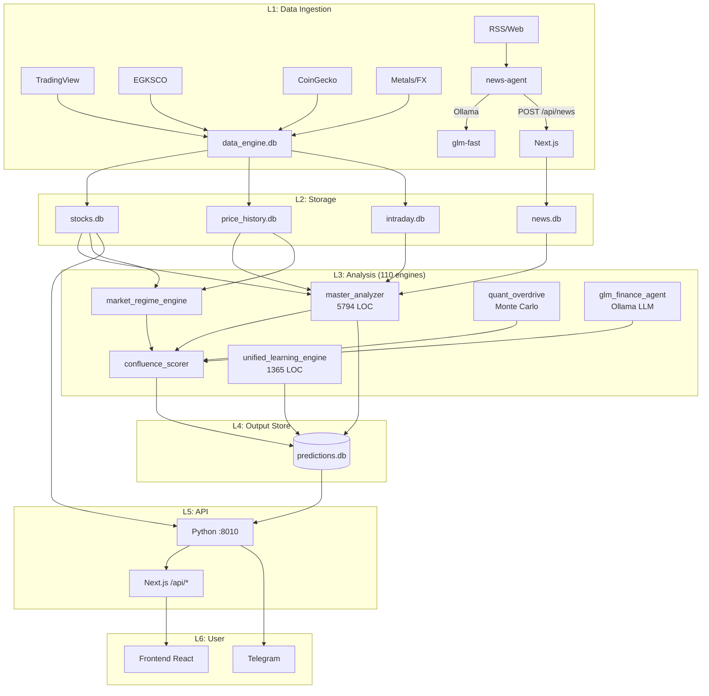

---

## 7. المحرك المركزي: master_analyzer.py

هذا هو **العقل المدبر** — 5,794 سطر Python. يجمع **8 قواعد ذهبية** + 9 مصادر دليل.

### 7.1 مخطط الإدخال/المعالجة/الإخراج

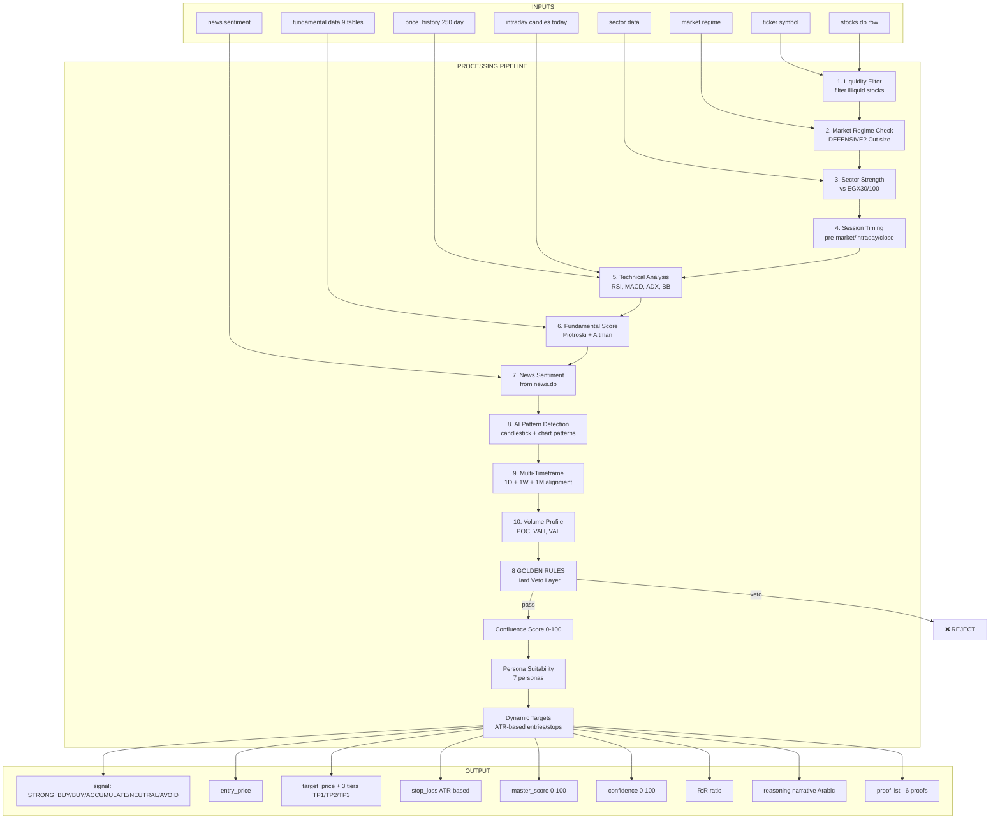

### 7.2 الـ 8 قواعد ذهبية (Hard Veto)

| # | القاعدة | الشرط | النتيجة |
|---|---|---|---|
| 1 | Liquidity Floor | turnover < 1M EGP/day | AVOID |
| 2 | Stage 4 Hard Veto | price < 200SMA + 200SMA falling | STRONG_AVOID (بغض النظر عن score) |
| 3 | Earnings Blackout | within 3 days of earnings | NEUTRAL (wait) |
| 4 | Gap Down > 5% | gap down > 5% from prev close | AVOID 24h |
| 5 | Volume Spike Anomaly | volume > 5× avg + price up < 2% | distribution warning |
| 6 | Market Regime Override | Regime = DEFENSIVE + stock beta > 1.5 | half size + higher threshold |
| 7 | News Negative Sentiment | news sentiment < -0.6 in last 24h | AVOID 24h |
| 8 | Ticker Cooldown | within 7 days of last false signal | SKIP (ticker_cooldown.py) |

### 7.3 عتبات الإشارة (Thresholds)

```python
# من analyzers/canonical_signal.py (SSOT)
STRONG_BUY ≥ 78   # + persona fit + market regime aligned
BUY ≥ 65
ACCUMULATE ≥ 55   # build position gradually
NEUTRAL 45-54    # wait
AVOID < 45       # sell or stay away
STRONG_AVOID     # hard veto (Stage 4 etc.)
```

---

## 8. فهرس المحركات الـ110 (حسب الفئة)

### 8.1 — Master/Fusion Orchestrators (10 engines)

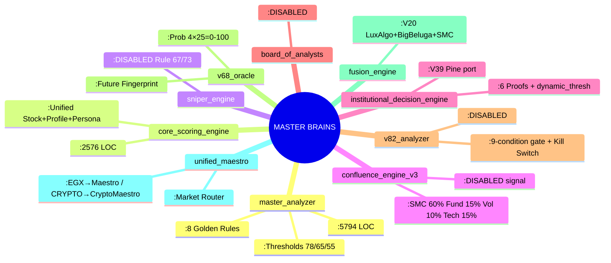

### 8.2 — Technical/Indicator (16 engines)

| Engine | LOC | ماذا يفعل |
|---|---|---|
| `technical.py` | 613 | RSI, MACD, ADX, BB canonical |
| `technical_weighted.py` | 542 | مؤشرات بأوزان حسب Regime |
| `technical_target_engine.py` | 888 | أهداف سعرية من المؤشرات |
| `technical_explainer.py` | 718 | تفسير عربي للمؤشرات |
| `enhanced_indicators.py` | 393 | مؤشرات مركبة |
| `multi_timeframe_engine.py` | 317 | 1D + 1W + 1M alignment |
| `live_indicator_engine.py` | 1143 | delta لحظي من cached_analysis |
| `intraday_reader.py` | 291 | قراءة intraday.db |
| `candlestick.py` | 492 | أنماط الشموع اليابانية |
| `candle_probability_engine.py` | 377 | احتمالات الشموع |
| `patterns.py` | 281 | H&S, Double Top, Triangles |
| `fibonacci.py` | 281 | retracement + extension |
| `volume_profile.py` | 344 | POC, VAH, VAL |
| `smc_engine.py` | 452 | Order Blocks + FVG + Liquidity Sweeps |
| `multi_path_detector.py` | 502 | multi-scenario paths |
| `support_resistance_calculator.py` | 943 | fractal pivots |

### 8.3 — Regime/Risk/Liquidity (15 engines)

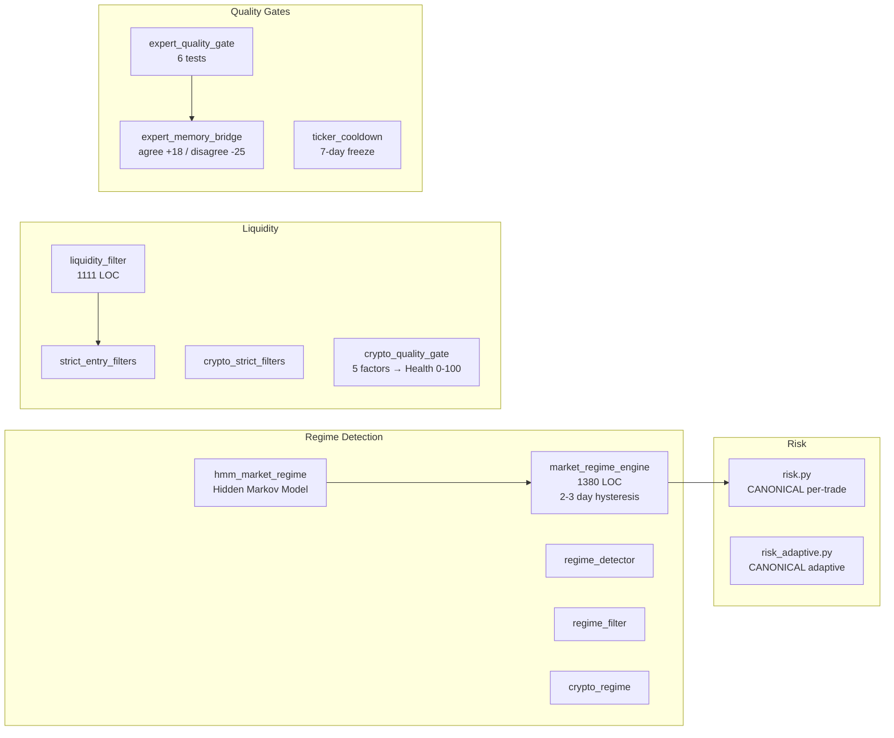

### 8.4 — Fundamental/Seasonality/Sector (12 engines)

| Engine | ماذا يحسب |
|---|---|
| `fundamental.py` | الأساسيات الكلاسيكية |
| `fundamental_engine.py` | محرك أساسي موحّد |
| `fundamental_relative.py` | P/E نسبة للقطاع |
| `fundamental_scorer.py` | **Piotroski F-Score + Altman Z-Score** |
| `fair_value_calculator.py` | قيمة عادلة (DCF) |
| `real_return_engine.py` | عائد حقيقي بعد التضخم |
| `seasonality_scorer.py` | أفضل/أسوأ شهور للسهم |
| `dividend_checker.py` | توزيعات أرباح |
| `sector_relative.py` | أداء نسبي للقطاع (18 قطاع EGX) |
| `backtest_engine.py` | Walk-Forward Validation |

### 8.5 — Prediction Tracking/Learning (12 engines)

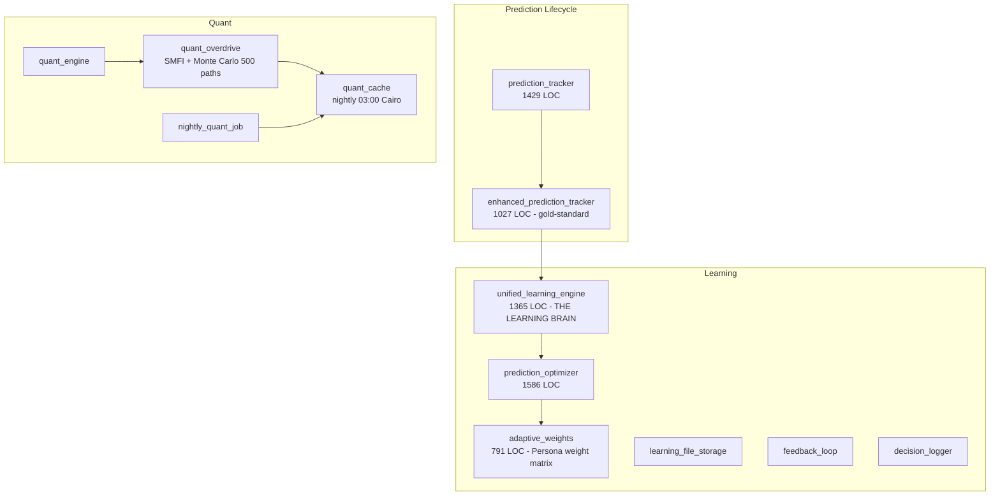

#### تفصيل unified_learning_engine (العقل التعلّمي)

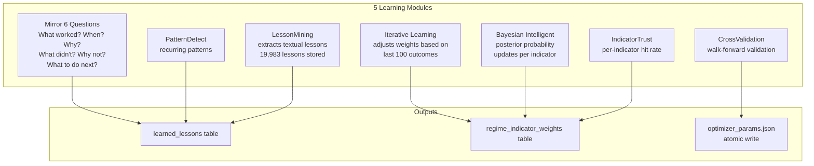

### 8.6 — Persona/Position/Portfolio (10 engines)

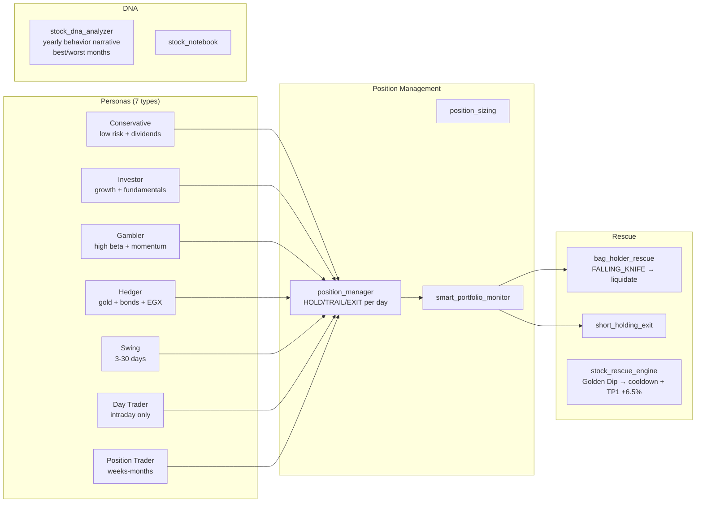

### 8.7 — Reporting (8 engines)

| Engine | المخرج |
|---|---|
| `narrative_generator.py` | تفسير عربي للقرار |
| `social_card_generator.py` | صورة بطاقة للسوشيال ميديا |
| `reports_engine.py` | PDF reports |
| `market_daily_report.py` | تقرير يومي شامل |
| `conviction_engine.py` | MAX 15% / NORMAL 10% position |
| `confidence_engine.py` | 7 factors × 0-15 = 0-100 |

### 8.8 — Canonical Indicator Library (10 files)

```python
# analyzers/indicators/ — THE SSOT (Rule 54)
# كل المحركات الأخرى يجب أن تستدعي هذه، لا أن تعيد الحساب
adx.py              # 143 LOC - ADX/DI+/DI-
atr.py              # 74 LOC - Wilder ATR
bollinger.py        # 119 LOC - BB upper/middle/lower
flow_indicators.py  # 367 LOC - MFI + CMF + OBV
ma.py               # 125 LOC - SMA/EMA/MACD
mfi.py              # 98 LOC - Money Flow Index
rsi.py              # 66 LOC - RSI Wilder
srsi.py             # 125 LOC - Stochastic RSI
volume_profile.py   # 132 LOC - POC/VAH/VAL
vwap.py             # 103 LOC - Volume Weighted Average Price
```

---

## 9. منطق الـ Confluence Scoring

الـ Confluence هو **الاتحاد النهائي** لكل الأدلة. كل محرك ينتج score جزئي، والـ confluence_scorer يدمجها بأوزان نسبية.

### 9.1 — معادلة الـ Confluence الكلية

```
FINAL_SCORE = w1×Tech + w2×SMC + w3×Vol + w4×Fund + w5×Regime + w6×Persona + w7×Season + w8×News

حيث الأوزان الافتراضية (Confluence Engine V3):
  w1 = 0.15  (Technical 15%)
  w2 = 0.60  (SMC 60%) ←—the dominant signal
  w3 = 0.10  (Volume 10%)
  w4 = 0.15  (Fundamentals 15%)

ثم ضرب في liquidity_multiplier (0.5 - 1.2)
ثم ضرب في regime_multiplier (DEFENSIVE=0.7, NORMAL=1.0, AGGRESSIVE=1.15)
ثم persona_fit_bonus (-10 إلى +15)
```

### 9.2 — خريطة الأوزان

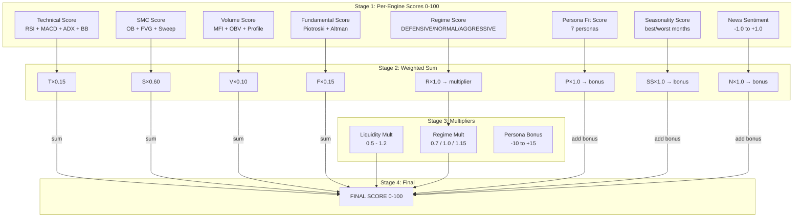

### 9.3 — Minervini Confluence (الـ 5 محركات الأصلية)

```python
# glminvestment_engines/confluence/confluence_scorer.py
WEIGHTS = {
    'donchian':    0.30,   # Turtle breakout
    'atr':         0.25,   # Wilder risk
    'stage2':      0.20,   # Minervini trend
    'vcp':         0.10,   # Volatility Contraction
    'persona':     0.10,   # Persona fit
    'seasonality': 0.05,   # Calendar effects
}

# HARD VETO: if EGX30 < SMA200 → STRONG_AVOID regardless of score
```

---

## 10. نظام Market Regime

### 10.1 — الثلاث حالات

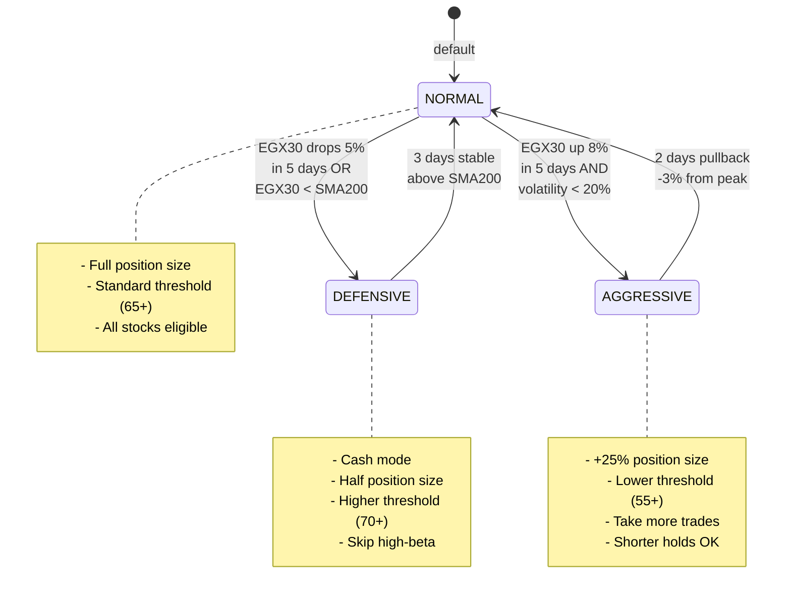

### 10.2 — آلية الـ Hysteresis

لمنع التذبذب السريع بين الحالات (flip-flop):

```python
# analyzers/market_regime_engine.py
HYSTERESIS_DAYS = {
    'DEFENSIVE → NORMAL': 3,  # يتطلب 3 أيام استقرار فوق SMA200
    'NORMAL → DEFENSIVE': 1,  # فوري يوم واحد هبوط حاد
    'AGGRESSIVE → NORMAL': 2, # يتطلب يومين pullback
    'NORMAL → AGGRESSIVE': 5, # يتطلب 5 أيام صعود مستمر
}

# Stored in stocks.db.system_settings key='current_regime_EGX'
# Read by: daily_predictor, liquidity_filter, position_sizing, /api/market/regime
```

### 10.3 — من يقرأ الـ Regime؟

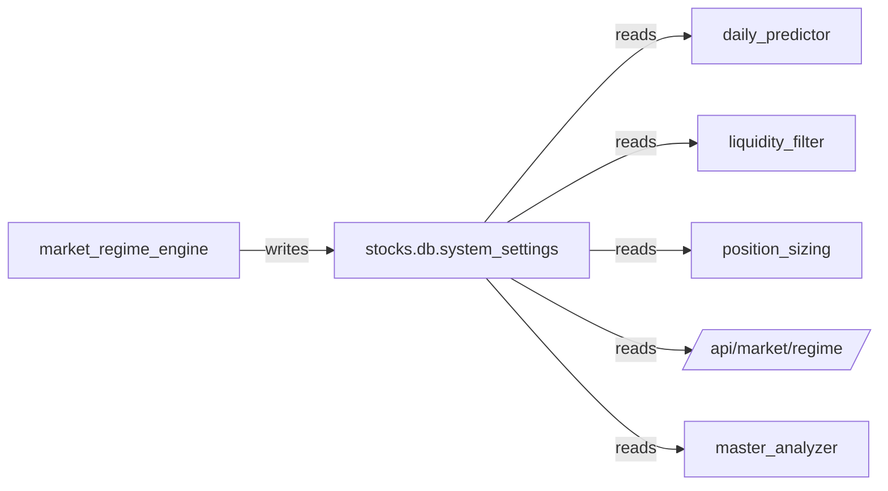

---

## 11. تصنيف Minervini للمراحل (Stage 1-4)

نظام Mark Minervini SEPA (Specific Entry Point Analysis) يصنّف كل سهم إلى واحدة من 4 مراحل:

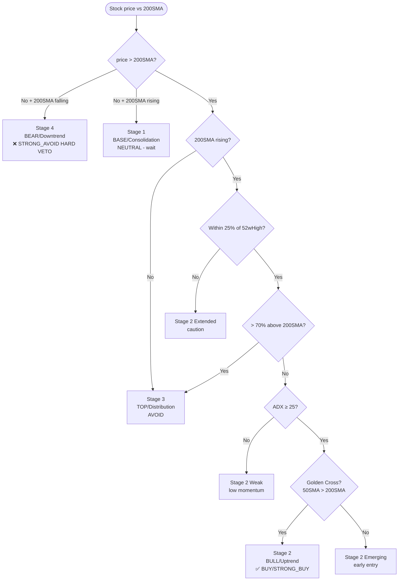

### جدول المراحل

| Stage | الاسم | الشرط الفني | الإشارة | أمثلة سلوكية |
|---|---|---|---|---|
| 1 | Base / Consolidation | price ≈ 200SMA flat | NEUTRAL (wait) | تجميع، انقباض حجمي |
| 2 | Uptrend / Bull | price > 200SMA rising + Golden Cross + ADX≥25 + ≤25% from 52wHigh + ≤70% above 200SMA | **BUY / STRONG_BUY** | VCP, breakout, volume surge |
| 3 | Distribution / Top | price > 200SMA but 200SMA flat or price > 70% above | AVOID | lower highs, volume divergence |
| 4 | Downtrend / Bear | price < 200SMA + 200SMA falling | **STRONG_AVOID (HARD VETO)** | lower lows, death cross |

### تطبيق في الكود

```python
# glminvestment_engines/engines/stage2_filter.py
def classify_stage(price_data):
    price = price_data[-1].close
    sma200 = SMA(price_data, 200)[-1]
    sma50 = SMA(price_data, 50)[-1]
    high_52w = max(c.close for c in price_data[-260:])
    adx = ADX(price_data, 14)[-1]
    
    if price < sma200 and sma200 < SMA(price_data, 200)[-2]:
        return 'Stage 4'  # HARD VETO
    if price < sma200:
        return 'Stage 1'
    if sma200 > SMA(price_data, 200)[-2]:
        return 'Stage 3'  # distribution
    if (price - high_52w) / high_52w > -0.25:
        if price / sma200 - 1 <= 0.70:
            if adx >= 25 and sma50 > sma200:
                return 'Stage 2'  # BUY
            return 'Stage 2 Emerging'
        return 'Stage 3'
    return 'Stage 2 Extended'
```

---

## 12. نظام الـ Personas (7 أنماط مستثمر)

النظام لا يصدر توصية "واحدة تناسب الجميع". بدلاً من ذلك، يحسب لكل سهم مدى ملاءمته لـ 7 شخصيات مختلفة:

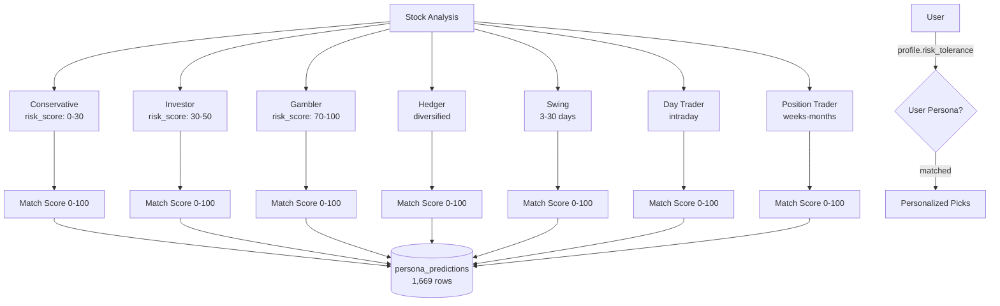

### مصفوفة الأوزان حسب الـ Persona (adaptive_weights.py)

| Persona | SMC | Fund | Tech | Volume | Regime | Season | News |
|---|---|---|---|---|---|---|---|
| Conservative | 0.15 | **0.50** | 0.10 | 0.05 | 0.15 | 0.03 | 0.02 |
| Investor | 0.20 | 0.35 | 0.15 | 0.10 | 0.10 | 0.05 | 0.05 |
| Gambler | **0.45** | 0.05 | 0.25 | 0.15 | 0.05 | 0.03 | 0.02 |
| Hedger | 0.10 | 0.30 | 0.05 | 0.05 | 0.20 | 0.05 | 0.25 |
| Swing | 0.30 | 0.15 | 0.25 | 0.15 | 0.10 | 0.03 | 0.02 |
| Day | 0.25 | 0.05 | **0.40** | 0.20 | 0.05 | 0.02 | 0.03 |
| Position | 0.20 | 0.25 | 0.15 | 0.10 | 0.20 | **0.07** | 0.03 |

> لاحظ كيف يتم تفضيل SMC عند الـ Gambler، وFundamentals عند الـ Conservative/Hedger، وTechnical عند الـ Day Trader.

---

## 13. حلقة التعلم الذاتي (Learning Loop)

```mermaid
flowchart LR
    subgraph "Day T"
        P1[Prediction generated<br/>signal=BUY, entry=12.5, target=14.0, stop=11.8]
    end
    
    subgraph "Day T+1"
        P2[Market opens<br/>paper_trade executes]
        M1[price moved to 12.7<br/>+1.6%]
    end
    
    subgraph "Day T+5"
        M2[price reached 13.8<br/>near TP1]
        O1[Outcome Log #1<br/>5-day return: +10.4%<br/>status: WIN_PENDING]
    end
    
    subgraph "Day T+10"
        M3[price reached 14.1<br/>TP hit!]
        O2[Outcome Log #2<br/>10-day return: +12.8%<br/>status: WIN<br/>exit_type: TARGET_HIT]
    end
    
    subgraph "Day T+11"
        L[Lesson Extraction]
        L --> L1[Indicator Trust:<br/>RSI=68%, MACD=71%, ADX=55%]
        L --> L2[Pattern:<br/>VCP+breakout worked in Stage 2]
        L --> L3[Lesson Text:<br/>"Stage 2 + VCP + ADX>30 → +10% in 10 days"]
        
        L1 --> W[Update regime_indicator_weights]
        L2 --> S[Update stock_stories]
        L3 --> LL[Insert learned_lessons<br/>19,983 total]
        
        W --> NextPred[Day T+12 prediction<br/>uses updated weights]
    end
    
    P1 --> P2
    P2 --> M1
    M1 --> M2
    M2 --> O1
    O1 --> M3
    M3 --> O2
    O2 --> L
```

### آلية التعلّم التفصيلية

```python
# analyzers/unified_learning_engine.py (THE LEARNING BRAIN - 1365 LOC)

# 5 modules work in parallel:

# 1. Iterative Learning
#    - Takes last 100 outcomes
#    - For each indicator: count(WIN) / count(TOTAL)
#    - If hit_rate > 0.60 → boost weight by 5%
#    - If hit_rate < 0.40 → cut weight by 10%
#    - Writes: regime_indicator_weights

# 2. Bayesian Intelligent
#    - Prior: current weight distribution
#    - Likelihood: P(outcome | indicator on)
#    - Posterior: updated weight
#    - Uses: beta distribution conjugate prior

# 3. Mirror (6 Questions)
#    - What worked?
#    - When did it work?
#    - Why did it work?
#    - What didn't work?
#    - Why not?
#    - What to do next?
#    → generates textual lessons for LLM consumption

# 4. IndicatorTrust
#    - Per-indicator hit rate over last 200 trades
#    - If < 0.45 → DISABLE indicator
#    - If > 0.65 → mark as "high-trust"

# 5. CrossValidation
#    - Walk-forward: train on months 1-5, test on month 6
#    - If accuracy drops > 10% → regime shift detected
#    - Writes: optimizer_params.json (atomic)
```

### إحصائيات التعلم الحالية

| Metric | Value |
|---|---|
| Total predictions logged | 1,499 active + 4,035 evaluated |
| Outcome logs (1/5/10/20-day) | 8,544 |
| Learned lessons (text) | 19,983 |
| Historical trades (backtest) | 22,650 |
| Stock stories (RAG) | varies |
| Iterative weight updates | continuous |
| Quant cache snapshots | 03:00 Cairo daily |

---

## 14. ثلاثة مسارات تدفق بيانات كاملة

### 14.1 — مسار التوصية اليومية (Daily Prediction)

```mermaid
sequenceDiagram
    participant CRON as Cron<br/>(14:30 Cairo)
    participant DP as daily_predictor<br/>4730 LOC
    participant MA as master_analyzer
    participant SC as confluence_scorer
    participant RG as market_regime_engine
    participant PR as predictions.db
    participant TP as telegram_poster
    participant TG as Telegram Channel
    participant DC as daily_closer<br/>(T+1..T+N)
    participant TR as prediction_tracker
    
    CRON->>DP: trigger --today-only
    
    DP->>RG: get current_regime_EGX
    RG-->>DP: NORMAL
    
    loop For each stock (1,240 EGX stocks)
        DP->>MA: analyze(ticker, regime=NORMAL)
        
        MA->>MA: 1. Liquidity Filter
        MA->>MA: 2. Stage Classifier
        MA->>MA: 3. Technical (RSI/MACD/ADX/BB)
        MA->>MA: 4. Fundamental (Piotroski/Altman)
        MA->>MA: 5. SMC (OB/FVG/Sweep)
        MA->>MA: 6. Volume Profile
        MA->>MA: 7. News Sentiment
        MA->>MA: 8. Multi-Timeframe
        MA->>MA: 9. 8 Golden Rules Veto
        
        MA->>SC: confluence(scores)
        SC-->>MA: FINAL_SCORE 0-100
        
        MA->>MA: persona_fit × 7
        MA->>MA: ATR-based targets (entry/stop/TP1/TP2/TP3)
        
        MA-->>DP: signal, score, entry, stop, targets, proofs
        
        opt Score >= 65 (BUY threshold)
            DP->>PR: INSERT predictions (was_published=0)
        end
    end
    
    DP->>DP: rank top picks per persona
    DP->>TP: send top 5 BUY picks
    
    loop For each pick
        TP->>TG: post recommendation card
        TP->>PR: UPDATE was_published=1
    end
    
    Note over DC,TR: Day T+1 to T+20
    
    loop Every market day
        DC->>PR: fetch active predictions
        loop For each active prediction
            DC->>DC: compute current P&L
            opt TP hit
                DC->>PR: exit_type=TARGET_HIT, pnl_pct=...
            end
            opt Stop hit
                DC->>PR: exit_type=STOP_LOSS, pnl_pct=...
            end
            opt Trailing exit
                DC->>PR: exit_type=TRAILING_EXIT
            end
            opt Time exit (20 days)
                DC->>PR: exit_type=TIME_EXIT
            end
        end
    end
    
    TR->>PR: aggregate outcome_logs (1d/5d/10d/20d)
    TR->>TR: extract lessons → learned_lessons
    TR->>TR: update regime_indicator_weights
```

### 14.2 — مسار إشارة الـ Maker Radar اللحظية

```mermaid
sequenceDiagram
    participant FE as Frontend<br/>MakerRadarTab
    participant NX as Next.js /api/maker-radar
    participant RC as radar-cache.ts
    participant SP as child_process.spawn<br/>scripts/maker_radar.py
    participant DE as data_engine.db
    participant ST as stocks.db
    participant PY as Python :8010
    participant WS as WS :3005
    
    FE->>NX: GET /api/maker-radar?market=EGX
    
    NX->>RC: readRadarCache(EGX)
    alt Cache fresh (< 5 min)
        RC-->>NX: cached JSON
    else Cache stale
        RC->>SP: spawn python maker_radar.py EGX
        SP->>DE: read egksco_price_history
        SP->>DE: read historical_data
        SP->>SP: compute 3 tracks:
        Note over SP: Track 1: Quiet Accumulation (vol≥2%)<br/>Track 2: Explosive Surge (vol≥2%)<br/>Track 3: Early Break (vol≥2.5%)
        SP->>RC: write db/maker_radar_tracking.json
        SP->>RC: write scripts/output/maker_radar_EGX_YYYYMMDD.json
        RC-->>NX: fresh JSON
    end
    
    NX->>ST: enrich with live prices (better-sqlite3)
    NX->>NX: trial-expiry gate check
    alt Free user
        NX-->>FE: 60min-delayed data
    else Premium user
        NX-->>FE: real-time data
    end
    
    FE->>WS: io("/?XTransformPort=3005")
    WS->>PY: poll /api/stocks every 2s during session
    PY-->>WS: price updates
    WS->>FE: emit "ticker:update" / "stock:alert"
    FE->>FE: live update without refresh
```

### 14.3 — مسار تحليل المحفظة (Portfolio Analysis)

```mermaid
sequenceDiagram
    participant U as User
    participant NX as Next.js /api/portfolio/holdings
    participant AH as auth-helper<br/>getSessionUserId
    participant AU as auth.db
    participant PY as Python :8010
    participant PR as ai/portfolio_routes.py
    participant ST as stocks.db
    participant DE as data_engine.db
    participant PD as predictions.db
    participant BHR as bag_holder_rescue
    participant SM as smart_portfolio_monitor
    
    U->>NX: GET /api/portfolio/holdings
    
    NX->>AH: getSessionUserId(req)
    AH->>AU: verify session/bearer/admin_cookie
    AU-->>AH: userId, isAdmin
    AH->>AU: UPDATE last_active_at (throttled)
    AH-->>NX: {userId, isAdmin}
    
    NX->>PY: proxy to ${PYTHON_BACKEND}/api/portfolio/holdings<br/>?XTransformPort=8010
    PY->>PR: route to FastAPI sub-router
    
    PR->>AU: SELECT portfolio_items WHERE user_id=?
    AU-->>PR: [{symbol, shares, purchase_price}]
    
    loop For each holding
        PR->>ST: SELECT current_price, sector, beta
        ST-->>PR: live price + metadata
        
        PR->>DE: SELECT fundamentals (tab_balance_sheets, tab_income_statements)
        DE-->>PR: P/E, P/B, ROE, debt ratio
        
        PR->>PD: SELECT latest prediction (signal, target, stop)
        PD-->>PR: BUY/SELL recommendation
        
        PR->>PR: compute P&L, equity, sector exposure
        PR->>BHR: check FALLING_KNIFE
        alt Stock down > 15% in 5 days
            BHR-->>PR: {action: LIQUIDATE, reason: FALLING_KNIFE}
        else Stock down 5-15% but fundamentals OK
            BHR-->>PR: {action: HOLD_COOLDOWN, TP1: +6.5%}
        end
        
        PR->>SM: check concentration risk
        alt Single position > 25% of equity
            SM-->>PR: {alert: OVER_CONCENTRATED}
        end
    end
    
    PR->>PR: aggregate: equity_curve, sector_breakdown, risk_summary
    PR-->>PY: JSON response
    PY-->>NX: 200 OK
    NX-->>U: portfolio dashboard data
```

---

## 15. طبقة الذكاء الاصطناعي (Ollama + RAG)

### 15.1 — المعمارية

```mermaid
flowchart TB
    subgraph "Local AI Stack"
        OL[Ollama Service<br/>:11434]
        M1[Model: qwen2.5:1.5b<br/>base]
        M2[Model: glm-fast:latest<br/>custom Modelfile]
        
        OL --> M1
        OL --> M2
    end
    
    subgraph "AI Layer (12 files)"
        GFA[glm_finance_agent.py<br/>228 LOC<br/>THE Ollama client]
        DE[decision_engine.py<br/>299 LOC<br/>RAG - find_similar_stories]
        NA[nightly_analysis.py<br/>389 LOC<br/>02:00 Cairo cron]
        LAI[live_ai_monitor.py<br/>604 LOC<br/>every 15min during session]
        HSD[hot_stocks_detector.py<br/>748 LOC]
        MNR[market_news_reader.py<br/>174 LOC]
        NAG[news_agent.py<br/>388 LOC<br/>DuckDuckGo + trafilatura]
        TR[trade_recorder.py<br/>1464 LOC]
        HTG[historical_trade_generator.py<br/>746 LOC]
        TSI[telegram_signal_importer.py<br/>818 LOC]
        PR2[portfolio_routes.py<br/>FastAPI sub-router]
    end
    
    subgraph "Anti-Hallucination"
        SP[SYSTEM_PROMPT<br/>forbids number fabrication]
        RG[RAG: stock_stories table]
        FN[Smart Fallback<br/>if Ollama down]
    end
    
    GFA -->|POST /api/generate| OL
    GFA --> SP
    DE --> RG
    NA --> GFA
    LAI --> GFA
    HSD --> LAI
    
    RG -->|find_similar_stories| DE
    DE -->|augment prompt| GFA
```

### 15.2 — الـ Prompt الإنشائي (Anti-Hallucination)

```python
# ai/glm_finance_agent.py
SYSTEM_PROMPT = """
You are GLM Finance Agent.
You receive structured market data and must:
1. NEVER fabricate numbers. If a metric is missing, say "غير متوفر".
2. Always ground your analysis in the provided indicators.
3. If uncertain, output "PROBABILITY_LOW" instead of guessing.
4. Output in Arabic, structured JSON format.
5. Reference similar past patterns from stock_stories (RAG).
6. Maximum 3 sentences per reasoning point.

You may use these patterns:
- Stage 2 breakout → 65% historical hit rate
- VCP after Stage 1 → 71% hit rate
- SMC Order Block + volume surge → 68% hit rate

Forbidden phrases:
- "I think" / "ربما" / "قد"
- Specific prices not in input
- Future dates with certainty
"""
```

### 15.3 — أين يدخل الـ AI فعلياً في القرار؟

```mermaid
flowchart LR
    subgraph "Layer 1: Data"
        D[stocks.db + price_history + news]
    end
    
    subgraph "Layer 2: Rule-based Engines"
        R1[master_analyzer]
        R2[confluence_scorer]
        R3[market_regime]
        R4[persona_fit]
    end
    
    subgraph "Layer 3: AI Augmentation"
        A1[Ollama LLM<br/>narrative generation]
        A2[RAG<br/>similar stories]
        A3[Live AI Monitor<br/>15min hot stocks]
    end
    
    subgraph "Layer 4: Final Score"
        F[confluence_score =<br/>maestro × 0.6 + ai × 0.4]
    end
    
    D --> R1 & R2 & R3 & R4
    D --> A2
    A2 --> A1
    R1 --> F
    A1 --> F
```

> **ملاحظة مهمة:** الـ AI **لا يتخذ القرار النهائي وحده**. هو يساهم بـ 40% فقط في الـ Confluence Score. الـ 60% الأخرى من المحركات الـ rule-based.

---

## 16. التحديث اللحظي (WebSocket)

### 16.1 — معمارية مزدوجة القناة

```mermaid
flowchart LR
    subgraph "Channel 1: Push (instant)"
        DE[data_engine sync.py] -->|POST /broadcast| WS[WS :3005]
        WS -->|socket.emit market:snapshot| FE[Frontend]
    end
    
    subgraph "Channel 2: Poll (backup)"
        WS -->|poll /api/stocks every 2s<br/>during session| PY[Python :8010]
        WS -->|poll /api/live/analysis every 30s| PY
        PY -->|JSON| WS
        WS -->|emit ticker:update| FE
    end
    
    subgraph "Channel 3: Telegram Events"
        TE[TE :3003] -->|poll /api/telegram/events every 2s| PY
        PY -->|events| TE
        TE -->|emit telegram:event| AdminTab[Admin TelegramTab]
    end
```

### 16.2 — أحداث socket.io

| Event | الاتجاه | التردد | البيانات |
|---|---|---|---|
| `market:snapshot` | WS → FE | عند كل sync | {EGX30, EGX100, top_movers} |
| `market:status` | WS → FE | كل 30s | {session: open/closed, next_event} |
| `ticker:update` | WS → FE | كل 2s | {ticker, price, change_pct, volume} |
| `stock:alert` | WS → FE | عند trigger | {ticker, alert_type, message} |
| `telegram:event` | TE → Admin | كل 2s | {message_id, channel, text} |

### 16.3 — قاعدة Caddy للـ WebSocket

```
# Caddyfile
?XTransformPort=3005 → localhost:3005  (socket.io)
?XTransformPort=3003 → localhost:3003  (socket.io)
?XTransformPort=8010 → localhost:8010  (Python API)
default             → localhost:3000  (Next.js)
```

⚠️ **في الكود الأمامي:** دائماً استخدم `io("/?XTransformPort=3005")` — **لا** `io("http://localhost:3005")`.

---

## 17. جدول القرارات (Decision Tables)

### 17.1 — Decision Tree الرئيسي

```mermaid
flowchart TD
    Start([طلب تحليل سهم]) --> L1{Liquidity OK?}
    L1 -->|No| REJECT[AVOID - illiquid]
    L1 -->|Yes| L2{Stage?}
    
    L2 -->|Stage 4| VETO[STRONG_AVOID HARD VETO]
    L2 -->|Stage 1| WAIT[NEUTRAL - wait]
    L2 -->|Stage 3| AVOID[AVOID - distribution]
    L2 -->|Stage 2| L3{Regime?}
    
    L3 -->|DEFENSIVE| L3a{Score ≥ 70?}
    L3 -->|NORMAL| L3b{Score ≥ 65?}
    L3 -->|AGGRESSIVE| L3c{Score ≥ 55?}
    
    L3a -->|Yes| L4
    L3a -->|No| NEUTRAL1[NEUTRAL]
    L3b -->|Yes| L4
    L3b -->|No| NEUTRAL2[NEUTRAL]
    L3c -->|Yes| L4
    L3c -->|No| NEUTRAL3[NEUTRAL]
    
    L4{News sentiment?} -->|<-0.6| NEWS_AVOID[AVOID 24h]
    L4{News sentiment?} -->|>=-0.6| L5{Ticker in cooldown?}
    
    L5 -->|Yes| SKIP[SKIP - 7d freeze]
    L5 -->|No| L6{Earnings within 3d?}
    
    L6 -->|Yes| EARN_NEUTRAL[NEUTRAL - earnings blackout]
    L6 -->|No| L7{Final score?}
    
    L7 -->|≥ 78| SB[STRONG_BUY]
    L7 -->|65-77| BUY[BUY]
    L7 -->|55-64| ACC[ACCUMULATE]
    L7 -->|< 55| AVOID_F[AVOID]
```

### 17.2 — Position Sizing Decision Table

| Regime | Score | Beta | Position Size | Stop Type |
|---|---|---|---|---|
| DEFENSIVE | 65-77 | < 1.0 | 5% of equity | ATR × 2.0 |
| DEFENSIVE | 65-77 | 1.0-1.5 | 3% of equity | ATR × 2.5 |
| DEFENSIVE | 65-77 | > 1.5 | SKIP | — |
| DEFENSIVE | ≥ 78 | < 1.0 | 7.5% of equity | ATR × 1.5 |
| DEFENSIVE | ≥ 78 | 1.0-1.5 | 5% of equity | ATR × 2.0 |
| DEFENSIVE | ≥ 78 | > 1.5 | 3% of equity | ATR × 2.5 |
| NORMAL | 65-77 | any | 7.5% of equity | ATR × 1.5 |
| NORMAL | ≥ 78 | any | 10% of equity | ATR × 1.5 |
| AGGRESSIVE | 55-64 | any | 7.5% of equity | ATR × 1.5 |
| AGGRESSIVE | 65-77 | any | 12.5% of equity | ATR × 1.2 |
| AGGRESSIVE | ≥ 78 | any | 15% MAX | ATR × 1.0 |

### 17.3 — Exit Strategy Decision Table

| Condition | Action | Exit Type |
|---|---|---|
| price ≥ TP3 | SELL 100% | TARGET_HIT |
| TP2 ≤ price < TP3 | SELL ⅓ + move stop to TP2 | UPDATE_TRAILING |
| TP1 ≤ price < TP2 | SELL ⅓ + move stop to BE | SELL_TIER_1 |
| price ≤ stop | SELL 100% | STOP_LOSS |
| price ≤ entry × 0.95 (5% loss) | SELL 100% (2% rule) | RISK_LIMIT |
| Day 20 reached | SELL 100% | TIME_EXIT |
| Trailing stop hit (after TP1) | SELL remaining | TRAILING_EXIT |
| FALLING_KNIFE detected | SELL 100% immediately | EMERGENCY_EXIT |
| Earnings within 1 day | SELL 50% (reduce risk) | PRE_EARNINGS_TRIM |

---

## 18. قائمة الـ Endpoints الكاملة (493)

### توزيع حسب الـ Method

| Method | Count |
|---|---|
| GET | 288 |
| POST | 198 |
| PUT | 1 |
| DELETE | 2 |
| **Total** | **493** |

### أهم الـ Endpoints حسب الفئة

#### تحليل وتوصيات
| Endpoint | Engine |
|---|---|
| `GET /api/analysis/<ticker>` | master_analyzer |
| `GET /api/predict/<ticker>` | master_analyzer |
| `GET /api/predictions/generate-all` | daily_predictor |
| `GET /api/predictions/daily-picks` | picks_management |
| `GET /api/confluence/analyze/<ticker>` | confluence_engine_v3 |
| `POST /api/confluence/generate-predictions` | confluence_engine_v3 |

#### تتبع التوقعات
| Endpoint | Engine |
|---|---|
| `GET /api/predictions/tracking/*` (10 endpoints) | prediction_tracker |
| `GET /api/predictions/active-management` | position_manager |

#### الـ AI
| Endpoint | Engine |
|---|---|
| `GET /api/ai/live/scan` | live_ai_monitor |
| `GET /api/ai/live/signals` | live_ai_monitor |
| `GET /api/ai/hot-stocks` | hot_stocks_detector |
| `POST /api/ai/trades/record` | trade_recorder |
| `GET /api/ai/historical/generate` | historical_trade_generator |
| `POST /api/ai/telegram/import` | telegram_signal_importer |
| `GET /api/ai/premium/predictions` | confluence (maestro×0.6 + ai×0.4) |

#### Risk Management (22 endpoints)
| Endpoint | Engine |
|---|---|
| `/api/risk/position-size` | risk_management_advanced |
| `/api/risk/stop-loss` | risk_management_advanced |
| `/api/risk/trailing` | risk_management_advanced |
| `/api/risk/portfolio-concentration` | risk_management_advanced |
| + 18 more | risk_management_advanced |

#### Admin (87 endpoints)
| Endpoint | Engine |
|---|---|
| `POST /api/admin/trigger-analysis` | master_analyzer |
| `POST /api/admin/run-daily-analysis` | daily_predictor |
| `POST /api/admin/historical-backfill/run` | historical_backfill_engine |
| `POST /api/admin/iterative-learning/run` | unified_learning_engine |
| `GET /api/admin/engine-settings` | engine_settings |
| + 82 more | various |

#### Market Data
| Endpoint | Engine |
|---|---|
| `GET /api/market/intraday-pressure` | market_master |
| `GET /api/market/investor-flows` | market_master |
| `GET /api/market/liquidity-radar` | market_master |
| `GET /api/market/top-movers` | market_master |
| `GET /api/regime/market` | market_regime_engine |
| `GET /api/regime/stock/<ticker>` | market_regime_engine |

#### Scanner
| Endpoint | Engine |
|---|---|
| `GET /api/scanner/quick` | screener |
| `GET /api/explosive/scan` | explosive_scanner |
| `GET /api/explosive/top` | explosive_scanner |
| `GET /api/flow/heatmap` | flow_system |
| `GET /api/flow/top` | flow_system |

#### Crypto
| Endpoint | Engine |
|---|---|
| `GET /api/crypto/<coin_id>/history` | crypto_engine |
| `GET /api/crypto/analyze/<coin_id>` | crypto_engine |
| `GET /api/crypto/flow/<symbol>` | crypto_engine |
| `GET /api/crypto/live` | crypto_engine |

#### Backtest & Learning
| Endpoint | Engine |
|---|---|
| `GET /api/v38-backtest/*` (6 endpoints) | backtest_engine |
| `GET /api/unified-learning/*` (16 endpoints) | unified_learning_engine |
| `GET /api/learning/*` (5 endpoints) | learning_routes |
| `GET /api/prediction-optimizer/*` (4 endpoints) | prediction_optimizer |

---

## 19. الجدول الزمني للـ Cron Jobs

```mermaid
gantt
    title الجدول الزمني للـ Cron Jobs (Cairo Time)
    dateFormat HH:mm
    axisFormat %H:%M
    
    section Pre-Market
    News Agent Polling        :active, news, 06:00, 14h
    
    section Market Hours (10-14:30)
    MarketScheduler tick (60s) :active, ms, 10:00, 4h
    Intraday Scanner (5min)    :active, is, 10:00, 4h
    Live AI Monitor (15min)    :active, lai, 10:00, 4h
    WS Hyper Polling (2s)     :active, ws, 10:00, 4h
    Crypto Lab (5min 24/7)     :active, cl, 00:00, 24h
    
    section Post-Market
    Daily Predictor (14:30)    :crit, dp, 14:30, 30m
    Daily Closer (14:35)       :crit, dc, 14:35, 1h
    Intraday Aggregator (15:00) :ia, 15:00, 30m
    Price History Safetynet    :phs, 15:00, 30m
    
    section Nightly
    Nightly Quant Cache (03:00) :crit, nq, 03:00, 1h
    Daily Portfolio Yield (03:00) :dpy, 03:00, 15m
    Nightly AI Analysis (02:00) :naa, 02:00, 1h
    
    section Hourly
    WAL Checkpoint             :active, wal, 00:00, 24h
    Price History Stale Monitor :phm, 00:00, 24h
```

### جدول تفصيلي

| Job | Schedule (Cairo) | Duration | Output |
|---|---|---|---|
| MarketScheduler.tick() | every 60s, 10:00-14:30 | 60s | updates intraday |
| Intraday Scanner | every 5min, 10:00-14:30 | 30s | writes intraday.db |
| Live AI Monitor | every 15min, 10:00-14:30 | 2min | writes live_ai_signals |
| WS Hyper Polling | every 2s, 24/7 | instant | pushes to frontend |
| Crypto Lab Scheduler | every 5min, 24/7 | 1min | writes crypto_predictions_log |
| Daily Predictor | 14:30 post-close | 30min | writes predictions.db.predictions |
| Daily Closer | 14:35 post-close | 1h | updates outcomes |
| Intraday Aggregator | 15:00 | 30min | aggregates to price_history |
| Price History Safetynet | 15:00 | 30min | Yahoo fallback |
| Nightly Quant Cache | 03:00 | 1h | writes quant_cache |
| Nightly AI Analysis | 02:00 | 1h | updates stored_analyses ai_* columns |
| Daily Portfolio Yield | 03:00 | 15min | writes wealth_tracking |
| WAL Checkpoint | hourly | 5s | PRAGMA wal_checkpoint(TRUNCATE) |
| Price History Stale Monitor | hourly | 5s | alerts if frozen |

---

## 20. معجم المصطلحات

| Term | المعنى |
|---|---|
| **ADX** | Average Directional Index — قوة الترند (≥25 = قوي) |
| **ATR** | Average True Range — تقلب السعر (Wilder) |
| **BOS** | Break of Structure — SMC اصطلاح لكسر هيكلية السعر |
| **Confluence** | التقاء عدة أدلة فنية في نفس الاتجاه |
| **FVG** | Fair Value Gap — فجوة قيمة عادلة (SMC) |
| **Golden Cross** | تقاطع 50SMA فوق 200SMA (إشارة صعود) |
| **HMM** | Hidden Markov Model — نموذج ماركوف المخفي |
| **Liquidity Sweep** | SMC اصطلاح لجمع السيولة قبل الانعكاس |
| **MFI** | Money Flow Index — مؤشر تدفق الأموال |
| **OB** | Order Block — كتلة طلبات مؤسسية (SMC) |
| **POC** | Point of Control — أعلى مستوى حجمي |
| **R:R** | Risk:Reward ratio |
| **R-multiple** | Van Tharp — الربح مقسوماً على المخاطرة |
| **Regime** | حالة السوق (DEFENSIVE/NORMAL/AGGRESSIVE) |
| **SEPA** | Specific Entry Point Analysis (Minervini) |
| **SMA** | Simple Moving Average |
| **SMC** | Smart Money Concepts |
| **Stage 1-4** | Minervini trend stages |
| **TP1/TP2/TP3** | Take Profit tiers (Douglas) |
| **VCP** | Volatility Contraction Pattern (Minervini) |
| **VWAP** | Volume Weighted Average Price |
| **WAL** | Write-Ahead Logging (SQLite) |
| **Walk-Forward** | backtest method — train on past, test on next |

---

## خاتمة

هذا النظام ليس "نظام تداول آلي" بالمعنى التقليدي. هو **مساعد قرار هجين** يجمع بين:

1. **القواعد الهندسية** (110 محرك) — مبنية على نظريات Minervini, Wilder, Covel, Douglas, Lynch
2. **الإحصاء** (Bayesian + HMM + Monte Carlo) — لتعديل الأوزان ديناميكياً
3. **الـ LLM المحلي** (Ollama + glm-fast) — للتفسير والسياق
4. **حلقة التعلم الذاتي** (8,544 outcomes + 19,983 lessons) — تحسّن نفسها يومياً

**الفلسفة الجوهرية:** لا يوجد مؤشر واحد كافٍ. القرار الصحيح يحتاج التقاء (Confluence) عدة أدلة + سياق السوق الكلي + ملاءمة شخصية المستثمر + تعلّم من الأخطاء السابقة.

---

> **المراجع:**
> - `Documentation/03-HOW-IT-THINKS.md` (الإصدار السابق، 444 LOC)
> - `Documentation/04-ENGINES-ARCHITECTURE.md`
> - `Documentation/ENGINES-MASTER-REFERENCE.md`

---

## 21. تحديث رادار السيولة — Forensic Fixes (2026-10-25)

> **مهم:** هذا القسم يوثّق إصلاحات تمت على فرع `fix/radar-closure-final` (commit `b253243`). **لم تُدمج إلى main بعد** — بانتظار موافقة المالك. النص أدناه يعكس الحالة الحقيقية للنظام بعد الإصلاح.

### 21.1 — مشكلة عزل السوق (Market Contamination)

**السبب الجذرى المُثبت:**
- `stock_daily_prices.market TEXT DEFAULT 'US'` — الـ schema default خاطئ (يجب `'EGX'`)
- `eodhd_fetcher.py:195` + `daily_price_updater.py:165` — INSERT بدون `market` column → DEFAULT 'US' يطبّق
- `UNIQUE(ticker, price_date)` — `market` ليس جزء من المفتاح → same-ticker-different-market يصطدم
- 427 من 461 EGX ticker (93%) اتلوّثوا يوم **2026-10-08** (single batch event)

**الإصلاح المُنفّذ (C2 — Market Isolation):**
أضيف `market_filter='EGX'` لكل استعلامات الأسعار:
- `scripts/verify_radar_signals.py` — `_fetch_n_sessions_from_sources(market_filter='EGX')`
- `scripts/radar_accuracy_report.py` — `AND market='EGX'` فى `build_price_index`
- `src/app/api/maker-radar/signal-tracker/verify/route.ts` — `marketClause` فى `fetchPricesAfter`
- `scripts/generate_unified_audit.py` — filter عبر `fetch_nth_session_unified_or_ph`

**الـ schema migration (مقترح، غير منفّذ):**
```sql
-- مقترح: DEFAULT 'US' → DEFAULT 'EGX'
-- مقترح: UNIQUE(ticker, price_date) → UNIQUE(ticker, price_date, market)
```

### 21.2 — عدّ جلسات التداول (F1-v2)

**المشكلة:** `verify_radar_signals.py` كان بيحسب `signal_date + timedelta(days=7)` (calendar days) — ده بياخد أول سعر بعد 7 أيام تقويمية، مش الجلسة السابعة الفعلية. عطلات الجمعة+السبت بتتخطى، فالنتيجة بتكون الجلسة 5 أو 6 مش 7.

**الإصلاح:** `_fetch_n_sessions_from_sources()` بتجلب أول N صف `ORDER BY date ASC LIMIT N` — ده بيطابق الـ TS route `prices[N-1]` تماماً. العطلات والويكاند بتتخطى تلقائياً.

### 21.3 — طفرة السيولة (F3-v2)

**المشكلة:** `has_volume_surge()` كان بيستخدم `volumes[-20:]` كـ baseline — ده بيتداخل مع `recent_vol = volumes[-5:]`، فآخر 5 جلسات بتحسب فى البسط والمقام → نسبة منحازة.

**الإصلاح:** `volumes[-(surge_lookback + base_lookback):-surge_lookback]` = `volumes[-25:-5]` (غير متداخل). **لا fallback** — لو <25 جلسة، الرفض واضح بدل استخدام baseline متداخل.

### 21.4 — حالة `stale_data`

**الـ writers:**
- `maker_radar.py:806` — `initial_status = 'stale_data' if staleness_days > 3` (عند INSERT)
- `backfill_stale_radar_signals.py:179` — UPDATE retroactive لو age > 7 أيام

**الـ outcome_7d للـ stale signals:**
- 259 من 432 stale_data signals ليها `outcome_7d` SET
- دى كتبها `radar_accuracy_report.py --write` (بيعالج ALL signals، `WHERE signal_date >= cutoff`)
- `verified_at = NULL` لأن `verify_radar_signals.py` بيتعامل مع `status='pending'` فقط

**السياسة (3 خيارات للمالك):**
- Option A: استبعاد stale_data من إحصائيات الدقة
- Option B: فئة منفصلة (توصية برافو)
- Option C: إعادة حساب + تضمين

### 21.5 — فجوات جلسات EGX

| التاريخ | الحالة | السبب |
|---|---|---|
| 2026-10-06 (Tue) | ✅ عطلة مؤكدة | Armed Forces Day — EGX مغلقة |
| 2026-10-15 (Thu) | ⚠️ غير محسوم | كل 461 ticker غايبين، لا إفصاح موثّق |
| 2026-10-17 (Sat) | ⚠️ غير محسوم | صف موجود بـ `market='EGX'` فى `historical_data` — يوم سبت |

### 21.6 — الإجراءات الرأسمالية

| Ticker | الحدث | المعامل | الحالة |
|---|---|---|---|
| POUL | اندماج + زيادة رأس مال (Sep 28) | 0.2542 (close-to-close) | 🟡 غير محسوم (6.27% خطأ vs reference 10.36) |
| ORHD | أسهم مجانية 2328:721 (Oct 7) | 0.30967 | ✅ مؤكد (0.09% خطأ) |
| MENA | لا إجراء (data glitch) | N/A | ⚠️ بيانات فاسدة (127→6.68 revert) |

### 21.7 — الأرقام بعد الإصلاح

| Metric | Stored (قبل) | Post-fix (بعد C2) |
|---|---|---|
| Total signals | 1,329 | 1,329 |
| Compared | 438 | 438 |
| Win Rate | 42.7% | **28.3%** |
| Changed (>0.5% diff) | — | 343 (78%) |

**ملاحظة:** 28.3% نتيجة وسيطة، مش نهائية. تحتاج حل A3 (schema) + A4 (stale policy) + A5 (session gaps) قبل الاعتماد النهائى.

### 21.8 — ملفات الأدلة

| الملف | السجلات |
|---|---|
| `tool-results/MARKET_CONTAMINATION_AUDIT.csv` | 1,103 tickers |
| `tool-results/EGX_SESSION_GAPS.csv` | 1,822 gap records |
| `tool-results/STALE_SIGNAL_OUTCOMES.csv` | 432 signals |
| `tool-results/audit_signal_fate.csv` | 1,329 rows (per-signal) |
| `Documentation/BRAVO-RADAR-CLOSURE-01.md` | تقرير الإغلاق الكامل |

### 21.9 — حالة الاعتماد

- ✅ السبب الجذرى مُثبت
- ✅ الإصلاح (C2) مُنفّذ + مُختبَر (37/37 PASS)
- ❌ Schema migration — بانتظار موافقة المالك
- ❌ Writer fixes — بانتظار موافقة المالك
- ❌ Data cleanup — بانتظار موافقة المالك
- ❌ Merge لـ main — بانتظار موافقة المالك
> - `Documentation/01-ARCHITECTURE.md`
> - `Documentation/00-CONSTITUTION.md`
> - الكود المصدري في `/home/z/my-project/vps-service/`

*هذه الوثيقة هي المرجع المعماري الكامل النهائي للنظام.*
